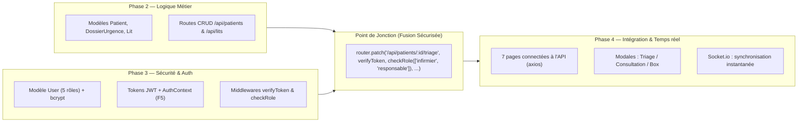

# 🏥 Dossi'Com — Gestion des Urgences Hospitalières

> **Application web complète de gestion et de suivi du parcours patient aux urgences hospitalières.**
> Projet Web INDP2 — SUP'COM — Groupe 6 (Wassim Ben Ameur · Wassim Triki)

**État du projet : Phase 2 (Métier) ✅ · Phase 3 (Auth JWT + RBAC) ✅ · Phase 4 (Frontend ↔ Backend + Temps réel) ✅**
La Phase 5 (tests finaux, variables d'environnement, déploiement) est préparée : voir la section « Déploiement ».

---

## 📌 Présentation du Projet

**Dossi'Com** est une solution numérique conçue pour fluidifier la prise en charge des patients aux urgences hospitalières, depuis l'admission administrative jusqu'à la sortie ou l'hospitalisation.

Le système intègre un contrôle d'accès basé sur les rôles (**RBAC — Role-Based Access Control**) et sécurise les échanges de données médicales sensibles grâce à une authentification stateless par **JSON Web Token (JWT)** et au hachage des mots de passe avec **bcrypt**. La **Phase 4** ajoute la synchronisation temps réel **Socket.io** entre les postes et les fenêtres d'action métier (triage IAO, consultation médicale, gestion des box).

---

## 🏗️ Architecture Globale

```
dossicom/
├── client/                     # Frontend (React 19, Vite, Tailwind CSS)
│   ├── src/
│   │   ├── assets/             # Logo officiel Dossi'Com
│   │   ├── components/
│   │   │   ├── common/         # Navbar, ProtectedRoute, Modal réutilisable
│   │   │   ├── patients/       # TriageModal, ConsultationModal   (Phase 4)
│   │   │   ├── lits/           # LitModal (états des box)          (Phase 4)
│   │   │   └── ui/             # PriorityBadge (charte P1–P4)
│   │   ├── context/
│   │   │   ├── AuthContext.jsx     # Session JWT + persistance F5  (Phase 3)
│   │   │   └── SocketContext.jsx   # Temps réel Socket.io          (Phase 4)
│   │   ├── hooks/
│   │   │   └── useApi.js       # Chargement API + temps réel + polling 15 s
│   │   ├── pages/              # 7 espaces + RegisterPage (compte patient)
│   │   ├── services/
│   │   │   └── api.js          # Axios + intercepteur JWT automatique
│   │   └── utils/              # tri.js (suggestion P1–P4), format.js
│   ├── package.json
│   ├── .env.example            # VITE_API_URL / VITE_SOCKET_URL
│   └── vite.config.js          # Proxy Vite API + WebSocket
│
├── server/                     # Backend API REST (Node.js, Express, MongoDB)
│   ├── src/
│   │   ├── config/db.js        # Connexion MongoDB robuste (messages d'aide)
│   │   ├── controllers/        # auth, patient, lit, stats
│   │   ├── middleware/         # verifyToken (JWT) & checkRole (RBAC)
│   │   ├── models/             # User, Patient, DossierUrgence, Lit
│   │   ├── routes/             # /auth, /patients, /lits, /stats
│   │   ├── socket/socket.js    # Socket.io + émission d'événements (Phase 4)
│   │   └── app.js              # Express + Helmet + CORS + serveur HTTP
│   ├── seed.js                 # Peuplement de la base (comptes, box, patients)
│   ├── .env / .env.example
│   └── package.json
│
└── README.md                   # Ce document
```

---

## 🔀 Fusion Phase 2 (Logique Métier) ↔ Phase 3 (Sécurité & RBAC)

Le projet fusionne les deux axes majeurs de développement :



---

## 👥 Matrice des Rôles & Permissions (RBAC)

| Rôle | Profil Métier | Accès Frontend | Permissions API Backend |
| :--- | :--- | :--- | :--- |
| **`accueil`** | Agent d'admission | `/accueil` | `POST /api/patients`, consultation de la file d'attente (lecture seule) |
| **`infirmier`** | IAO (Tri & Constantes) | `/infirmier` | `PATCH /api/patients/:id/triage` (constantes, P1 à P4) + traitement des alertes |
| **`medecin`** | Médecin urgentiste | `/medecin` | `PATCH /api/patients/:id/consultation` (diagnostic, prescriptions, clôture) |
| **`responsable`** | Chef de service | **Toutes les pages** | Accès universel + `PATCH /api/lits/:id` (gestion des box) |
| **`patient`** | Patient ou proche | `/patient` | Consultation exclusive de son propre dossier + alerte aggravation |

---

## 🚀 Guide de Démarrage Rapide

### Prérequis
- [Node.js](https://nodejs.org/) (version 18 ou supérieure)
- [MongoDB Community Server](https://www.mongodb.com/try/download/community) en cours d'exécution sur le port local `27017`

> ⚠️ **Si MongoDB n'est pas démarré, le serveur backend ne peut pas démarrer** — c'est la cause n°1 de l'erreur
> « Impossible de se connecter au serveur backend (http://localhost:5000) » sur la page de connexion.
> Le serveur affiche désormais un message d'aide détaillé : démarrer MongoDB **d'abord**, puis le backend.

### Ordre de démarrage (important)

```
1. MongoDB        (service système)
2. Backend server/ (port 5000)
3. Frontend client/ (port 5173)
```

### 1️⃣ Initialiser la Base de Données

Exécutez le script de *seeding* pour créer les comptes de test, les box et les dossiers patients de démonstration :

```bash
cd server
npm install   # une seule fois
npm run seed
```

**Résultat attendu :**
```text
✅ Connecté à MongoDB pour le seeding...
🗑️  Collections nettoyées.
✅ 5 Utilisateurs créés (Phase 3 RBAC)
✅ 8 Box/Lits créés.
✅ 4 Patients et Dossiers créés (tous statuts : P1, P2, P3, en attente de tri).
🎉 Fusion Phase 2 (Métier) & Phase 3 (Auth RBAC) prête et peuplée !
```

### 2️⃣ Démarrer le Serveur Backend

Dans le dossier `server/` :

```bash
npm run dev
```

> Le serveur démarre sur **`http://localhost:5000`** :
> ```text
> ✅ MongoDB connecté : localhost
> 🚀 Serveur Dossi'Com démarré sur http://localhost:5000
> ⚡ Socket.io prêt (temps réel) sur ws://localhost:5000
> 🌐 CORS autorisé pour : http://localhost:5173, http://127.0.0.1:5173, ...
> ```

### 3️⃣ Démarrer le Client Frontend

Dans un second terminal, dans le dossier `client/` :

```bash
npm install   # une seule fois
npm run dev
```

> L'application est accessible sur **`http://localhost:5173`**

---

## 🔑 Identifiants des Comptes de Démonstration

Des raccourcis **en 1 clic** sont disponibles directement sur la page [`/login`](http://localhost:5173/login) :

| Profil | Email | Mot de passe | Espace dédié |
| :--- | :--- | :--- | :--- |
| 🏥 **Accueil** | `accueil@dossicom.fr` | `Accueil@123` | [`/accueil`](http://localhost:5173/accueil) |
| 💉 **Infirmier IAO** | `infirmier@dossicom.fr` | `Infirmier@123` | [`/infirmier`](http://localhost:5173/infirmier) |
| 👨‍⚕️ **Médecin** | `medecin@dossicom.fr` | `Medecin@123` | [`/medecin`](http://localhost:5173/medecin) |
| 📊 **Responsable** | `responsable@dossicom.fr` | `Resp@123` | [`/responsable`](http://localhost:5173/responsable) |
| 🧑 **Patient** | `patient@dossicom.fr` | `Patient@123` | [`/patient`](http://localhost:5173/patient) |

> Seul le **patient** peut créer son compte en ligne (« Créer un compte patient » sur `/login` → `/register`).

---

## 📡 Documentation des Endpoints API

### 🔐 Authentification (`/api/auth`)

| Méthode | Route | Accès | Description |
| :--- | :--- | :--- | :--- |
| `POST` | `/api/auth/register` | Public | Inscription (compte patient) avec mot de passe haché par bcrypt |
| `POST` | `/api/auth/login` | Public | Connexion et délivrance du JWT |
| `GET` | `/api/auth/me` | Authentifié (`verifyToken`) | Vérification du profil et persistance session F5 |

### 🩺 Parcours Patient (`/api/patients`)

| Méthode | Route | Rôles Requis | Description |
| :--- | :--- | :--- | :--- |
| `POST` | `/api/patients` | `accueil`, `responsable` | Enregistrement du patient + création du dossier d'urgence |
| `GET` | `/api/patients` | Authentifié | File d'attente (les patients ne voient que leur dossier + position dans la file) |
| `GET` | `/api/patients/:id` | Authentifié | Dossier complet avec constantes, médecin et box peuplés |
| `PATCH` | `/api/patients/:id/triage` | `infirmier`, `responsable` | Saisie constantes vitales et attribution priorité P1–P4 |
| `PATCH` | `/api/patients/:id/consultation` | `medecin`, `responsable` | Diagnostic, ordonnance, compte-rendu et sortie (clôture → libère le box) |
| `POST` | `/api/patients/:id/aggravation` | `patient` | « Mon état s'aggrave » → alerte instantanée chez l'infirmier |
| `PATCH` | `/api/patients/:id/aggravation` | `infirmier`, `responsable` | Acquittement d'une alerte d'aggravation |

### 🛏️ Gestion des Box / Lits (`/api/lits`)

| Méthode | Route | Rôles Requis | Description |
| :--- | :--- | :--- | :--- |
| `GET` | `/api/lits` | `accueil`, `infirmier`, `medecin`, `responsable` | État en temps réel des box et patients affectés |
| `PATCH` | `/api/lits/:id` | `responsable` | Changement d'état (`libre`, `occupe`, `nettoyage`, `maintenance`) + affectation d'un patient (aucune double affectation possible) |

### 📊 Indicateurs (`/api/stats`)

| Méthode | Route | Accès | Description |
| :--- | :--- | :--- | :--- |
| `GET` | `/api/stats/public` | **Public** | Saturation, patients en attente, box libres, attente moyenne — aucune donnée nominative |

---

## ⚡ Temps réel (Phase 4 — Socket.io)

Le serveur émet 4 événements à tous les postes connectés ; le hook `useApi` recharge automatiquement les données à chaque événement (et toutes les 15 s en filet de sécurité, conformément à la charte technique).

| Événement | Émis lors de… | Effet visible |
| :--- | :--- | :--- |
| `patients:update` | Admission accueil, triage, consultation, clôture, alerte | Le patient apparaît instantanément chez l'Infirmier / Médecin / Responsable |
| `lits:update` | Affectation / libération de box, clôture d'un passage | La grille des box se met à jour sur tous les écrans |
| `stats:update` | Toute mutation | Le tableau de bord public recalcule ses indicateurs |
| `alerts:update` | « Mon état s'aggrave » (patient) / traitement (infirmier) | Bandeau rouge « Alertes à traiter » chez l'Infirmier |

---

## 🧪 Parcours de test de bout en bout (démo)

1. **Accueil** → remplir le formulaire → le patient obtient un numéro `DOS-XXXXXX`
2. **Infirmier** → le patient apparaît **instantanément** dans « Patients à trier » → « Évaluer » → saisir les constantes → une **suggestion indicative P1–P4** est calculée → confirmer la priorité (décision humaine) → observations → « Enregistrer le triage »
3. **Médecin** → le patient apparaît dans la file classée par priorité → « Consulter » → diagnostic, prescriptions (+/−), compte-rendu → « Enregistrer la consultation » ou « Clôturer le passage » (choix de l'orientation)
4. **Responsable** → la clôture a mis automatiquement le box en **nettoyage** → cliquer sur un box → changer son état / affecter un patient
5. **Patient** → suivi de son parcours (étapes, position dans la file, box, médecin) + bouton rouge « Mon état s'aggrave » → l'alerte apparaît **instantanément** chez l'Infirmier qui peut la traiter

---

## 🛠️ Dépannage (FAQ)

| Symptôme | Cause probable | Solution |
| :--- | :--- | :--- |
| « Impossible de joindre le serveur backend (http://localhost:5000) » sur `/login` | Backend non démarré **ou** MongoDB éteint (le serveur plante au démarrage) | Démarrer MongoDB (`services.msc` / `brew services start mongodb-community` / `sudo systemctl start mongod`), puis `cd server && npm run dev` |
| Le serveur affiche « Impossible de joindre MongoDB » | MongoDB hors service | Même solution — le message d'aide complet s'affiche dans la console du serveur |
| `CORS` / requêtes bloquées | Frontend démarré sur un port inhabituel | Les ports 5173, 5174 et 3000 sont autorisés ; sinon définir `CLIENT_URL` dans `server/.env` |
| « Route … non trouvée » (404) après login | Version ancienne du serveur | Utiliser le `server/` livré avec ce README |
| Les données ne se rafraîchissent pas | Socket.io coupé | Le polling 15 s prend le relais ; vérifier que le backend tourne puis recharger la page |
| Rester déconnecté après F5 | Token absent du localStorage | La session est revalidée via `GET /api/auth/me` au montage ; se reconnecter si le JWT a expiré (8 h) |

---

## 🚢 Déploiement (préparation Phase 5)

1. **Backend + MongoDB** : [Render](https://render.com) ou [Railway](https://railway.app) — provisionner un MongoDB Atlas, définir `MONGO_URI`, `JWT_SECRET` (longue chaîne aléatoire), `CLIENT_URL` (URL Vercel), `PORT`.
2. **Frontend** : Vercel ou Netlify — définir `VITE_API_URL=https://<votre-api>/api` et `VITE_SOCKET_URL=https://<votre-api>` (voir `client/.env.example`).
3. **Sécurité** : ne JAMAIS pousser les fichiers `.env` (ils sont déjà dans les `.gitignore`) ; utiliser les variables d'environnement de la plateforme.

---

## 🛡️ Sécurité & Bonnes Pratiques

- **Hachage fort** : `bcryptjs` avec un sel de 12 tours.
- **JWT sécurisé** : Durée de validité limitée à 8h avec signature secrète.
- **Middlewares serveur** : `verifyToken` (JWT) puis `checkRole` (RBAC) sur chaque route sensible — un compte patient ne peut jamais modifier un diagnostic (403 vérifié par les tests).
- **En-têtes sécurisés** : Intégration de `helmet` pour bloquer les vulnérabilités courantes (XSS, Clickjacking, MIME sniffing).
- **CORS strict** : Restreint aux origines autorisées (`http://localhost:5173` + ports de dev usuels).
- **Persistance frontend** : Stockage du token dans `localStorage` combiné à une revalidation automatique `GET /api/auth/me` au montage de l'application.
- **Masquage des données sensibles** : Champ `passwordHash` configuré avec `select: false` pour ne jamais fuiter dans les réponses JSON.
- **Règle métier** : la suggestion de priorité est indicative — le tri reste une décision humaine (l'infirmier confirme toujours manuellement).

---

## 🛠️ Technologies Utilisées

- **Frontend** : React 19, React Router v7, Tailwind CSS, Lucide React, Axios, **Socket.io-client**, Vite
- **Backend** : Node.js, Express, Mongoose (MongoDB ODM), **Socket.io**
- **Sécurité** : JSON Web Token (`jsonwebtoken`), `bcryptjs`, `helmet`, `cors`
